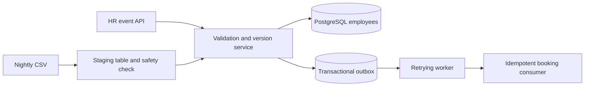
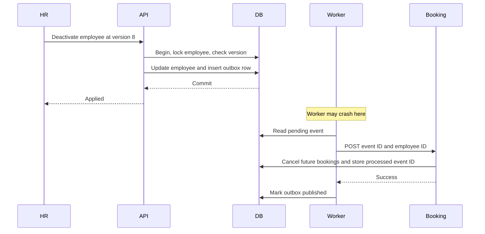

# Design note: HR roster sync

## Architecture

The API takes tenant identity from the authenticated membership, never the request body. Employee records, offices, bookings, imports, and outbox events carry tenant IDs. An employee role can view only its own employee ID; HR can submit changes; admin can edit transport-owned fields; operator can approve risky imports and view metrics. The internal event endpoint requires a separate token.

The canonical HR feed is a full HR-owned record with a monotonic per-employee integer version. Under a row lock, a lower version is ignored; an equal version with the same digest is a duplicate; an equal version with a different digest is a conflict; a higher version applies. HR updates do not touch transport-admin fields. PostgreSQL constraints prevent duplicate `(tenant, employee_id)` records. The nightly import uses a unique `(run, employee_id)` staging key and set-based SQL. Before applying it, the service compares staged IDs against active employees and requires operator review if the missing proportion reaches the threshold or any row is invalid.

## Hardest sequence: committed change, interrupted delivery

If the worker crashes after booking commits but before marking the outbox event published, it sends the same event again. The consumer recognizes the event ID and returns success without repeating the side effect. This is at-least-once delivery with an exactly-once database effect for this consumer.

## Failure behavior

| Failure | What the caller sees | Recovery |
|---|---|---|
| Duplicate or older HR event | `duplicate` or `stale` result | No write or new outbox event |
| Equal version with different content | `conflict` result | HR must issue a newer version |
| Invalid row in a batch | Per-record code and field | Good records continue; no personal value in errors |
| Incomplete nightly file | Run marked `needs_review` | No changes until operator approves |
| Worker stops after employee commit | API has already returned `applied` | Pending outbox event is retried on restart |
| Downstream timeout | Event remains pending | Exponential backoff with jitter; retry metrics rise |
| Duplicate downstream delivery | Same event ID delivered again | Processed-event table makes the side effect a no-op |
| Office cache misses an edit in another process | Validation can use an old office decision | Cache expires within 30 seconds |

## Complexity and consistency

An individual update is O(1) expected indexed lookup plus one transaction. Nightly staging and comparison are O(N) expected with database indexes, with O(1,000) application-side batch memory. The API favors fast acceptance of a committed change; downstream booking changes are eventually consistent until the outbox worker succeeds. The import safety brake deliberately favors avoiding mass deactivation over immediate roster freshness. PostgreSQL is the source of truth for due work and versions; local process clocks do not decide ordering.
